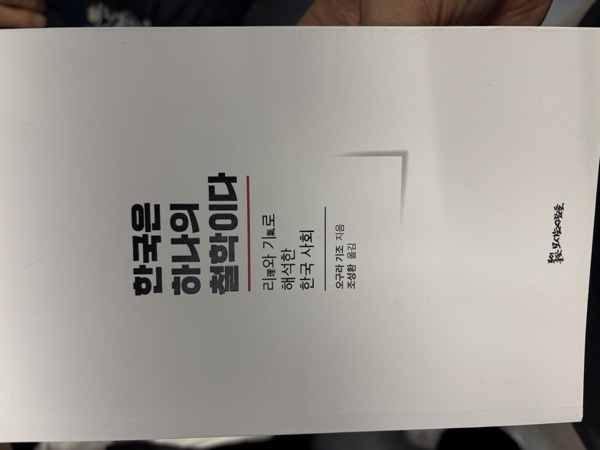

**분류:** 동양철학 · 한국학 · 사회비평 — 오구라 기조 지음, 조성환 옮김, 모시는사람들

**독서 구분:** 자유도서

동양철학, 그리고 우리나라의 주자학과 성리학은 이기론(이하 리기론)으로 세상을 설명하려고 한다. 『한국은 하나의 철학이다』는 그 리기론을 중심으로 이황, 이이 같은 조선의 위인들뿐만 아니라 현대의 한국 사회까지 관통하는 시선을 제공하는 책으로 느껴졌다.

그 옛날 팟캐스트 지대넓얕에서 동양철학 중 리기론을 다룬 회차를 들었던 적이 있는데, 물론 기억이 잘 나진 않는다. (생각해보니 내가 관심 있던 분야 말고는 잘 기억이 나질 않는 것 같다.) 그런데 이 책에서 리와 기의 차이, 리로 바라볼 수 있는 성악설과 성선설, 그리고 각종 스포츠의 형태까지 바라보는 걸 보면서, 리기론이 단순히 고리타분한 탁상공론으로 치부할 만한 개념은 아니라는 생각이 들었다. 세상을 바라보는 또 다른 훌륭한 관점으로 볼 수 있을 것 같았다.

물론 대부분의 철학이 그러하듯, 부분으로 전체를 혹은 부분을 전체로 해석하려는 시도가 있고 그 과정에서 비약을 범하거나 비약처럼 느껴지는 대목이 생기기 마련인데, 이 책도 예외는 아니었다. 하지만 이렇게 바라보는 시선도 있구나 하는 걸 알아가는 재미로 읽었다. 게다가 저자가 일본인이라는 점에서 오는 흥미로움이 책을 읽는 내내 느껴졌다.

흔히들 일본이 우리나라보다 앞서 있었기에 을사늑약이 체결되었고, 우리 역사에서 잊지 말아야 할 35년간의 일제강점기가 있었다고 이야기한다. 그런데 이 책을 읽고 나니 과거 우리 선조들이 왜 일본인들을 무시하고 살았는지 대략적으로나마 알 수 있었다. 일본은 우연히 우리나라보다 개항을 더 일찍 해서 앞서 나갈 수 있었던 것일 뿐이라는 생각의 비중이 더 올라간 것도 사실이다. 조선 건국 무렵에 이미 있었던 과거시험, 즉 공채 등용문에 해당하는 제도를 일본은 메이지 이후에야 실시했다는 것만 봐도 그렇다.

책에서는 우리나라의 인간관계를 님, 너, 놈 등으로 도식화해서 해석하는데, 그 규모는 피라미드 형태로 위로 올라갈수록 수가 적어진다. 관점에 따라서는 제대로 된 님의 개념은 임금 단 한 사람뿐이기도 하다. 반면 일본은 장인정신이든 무엇이든, 새로운 분야를 개척하든, 남들보다 최고인 무언가가 되기만 하면 님과 비슷한 포지션으로 자리매김할 수 있다. 이것은 곧 마이웨이를 가면 된다는 문화, 남들과의 경쟁보다는 남들과 다른 분야를 찾게 해주는 문화가 자리 잡을 수 있다는 뜻이기도 하다. 단 하나의 길 위에서 끊임없이 비교하는 우리나라 문화가 배워야 할 점처럼 보이기도 했다.

민족주의와 역사적인 관점에서 대부분의 한국인은 일본을 싫어하는(어찌 보면 자연스러운) 감정을 갖고 있지만, 역설적으로 그 감정은 일본 없이는 존재할 수가 없다. 그래서 저자는 이를 일본에 의존적인 한국의 리라고 표현하기도 한다. 실제로 괜히 일본과 비교해서 우리가 앞서고 있다는 관점을 굳이 가져오는 평론들도 많다. 굳이 일본이 아니더라도, 외부에 의존하는 그러한 시선이 우리나라에 매우 많은 건 사실이다.

다만 이건 리기론의 관점이라기보다는, 한국전쟁 이후 우리나라가 경제개발 모델을 만들 때 외부의 모델을 차용하고 기업 또한 패스트 팔로워 전략을 취해왔기 때문이라고 생각한다. 우리에게는 항상 따라잡아야 할 대상, 다시 말하면 비교의 대상이 있었고, 그것을 외부에 의존해 온 것은 맞는 사실인 것 같다. 지금은 반도체 일부 분야처럼 선도하는 분야도 생겼지만, 이러한 문화와 가치관은 하루아침에 바뀔 것 같진 않으니 당분간은 지속될 것 같기도 하다.

이 책을 읽고 떠오른 생각은 온고지신이라는 네 글자로 정리해 볼 수 있을 것 같다. 동양철학을 주 전공으로 하지 않는 이상 리기론에 그다지 관심을 가지지 않을 만큼, 지금은 비주류 관점처럼 보인다. 하지만 그 관점으로도 얼마든지 한국 사회를 바라볼 수 있다는 것을 알게 되었고, 심지어 외부에서 바라본 시선인 만큼 우리 스스로 바라본 시선과는 또 다른 배울 점이 있어 보인다. 예전에 대학 다닐 때 『제국의 후예』라는 책을 읽었었는데, 그때와 비슷한 느낌을 받았다. 생각난 김에 그 책도 조만간 다시 읽어봐야겠다.
