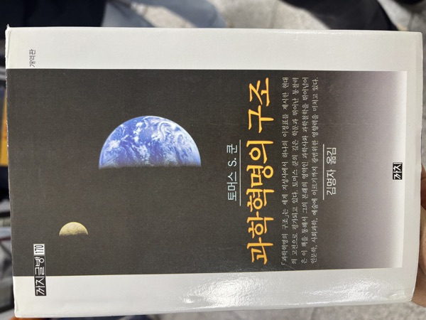

**분류:** 과학철학 · 과학사 — 토머스 S. 쿤 지음, 김명자 옮김, 까치

**독서 구분:** 자유도서

교양과학 콘텐츠나 과학 유튜브 채널을 통해 과학 이야기를 접하다 보면, 과학사와 관련된 내용도 종종 만나게 된다. 단순한 역사적 사실뿐만 아니라, 과학이 어떻게 발전해 왔고 그것을 왜 과학의 발전이라고 부를 수 있는지에 대해서도 듣곤 한다. 흔히 말하는 "거인의 어깨 위에 서 있다"는 표현도 자주 등장한다. 이렇게 과학사 이야기를 따라가다 보면 과학이 지금에 이르기까지 어떤 논쟁이 있었는지 짚어보게 되고, 짚다 보면 과학에 대해 과학을 하는 듯한 느낌, 즉 과학철학이라는 분야를 나도 모르게 접하게 된다. 내가 과학철학에 관심을 갖게 된 경위는 이랬던 것 같다.

이 책은 일반 대중을 대상으로 쓰였지만, 사실 한 번에 잘 읽히지는 않는다. 다만 위와 같은 콘텐츠를 조금이라도 접했다면, 강연자들이 이 책의 내용 일부를 시기적절하게 잘 활용했던 순간들이 군데군데 눈에 들어온다. 가령 교과서에 실려 마치 진리처럼 받아들여지는 과학 명제들이 수많은 검증과 비판을 이겨내고 나서야 실리게 되었다는 점, 그리고 특정 과학자 한 사람의 업적인 줄 알았던 것들도 사실은 비슷한 분야를 연구한 사람이 여럿 있었고, 간발의 차이로 후대에 남는 이름이 달라졌다는 점 등이 그렇다.

사실 이 책을 알게 된 건 꽤 오래전의 일이다. 지금처럼 과학에 본격적으로 관심을 갖기 전, 휴학하고 전문직 자격증 시험을 준비하던 2010년 즈음이었다. 당시 2차 시험 답안은 서술형이었는데, 시험 범위의 내용을 흡수하는 것보다 아는 것을 얼마나 논리적인 답안으로 구성해 잘 전달하느냐, 즉 출력이 더 중요할 수 있다며 강사님이 토머스 쿤의 『과학혁명의 구조』를 언급하셨다. 2차 답안을 쓸 때 참고하면 좋을 구성으로 쓰인 책이라는 이유였다. 물론 그때는 마음의 여유가 없어서였는지 읽을 생각조차 못 했다. 지금 생각해 보면 그때의 마음 상태로는 읽었다 한들 답안 구성에 큰 도움이 되었을 것 같지도 않다.

아무튼 알게 된 지 정말 오랜 시간이 지나서야 읽었는데, 이 책을 통해 알게 된 것은 많지 않다. 내용이 눈에 잘 들어오지 않았기 때문이다. 기억에 남는 것은 이런 것들이다. 20세기 초 상대성이론과 양자역학처럼 기존의 논리와는 다른 관점으로 자연현상을 설명하는 이론들이 등장했고, '혁명'이라는 표현 때문에 어느 한순간에 패러다임이 바뀌는 것처럼 느껴질 수 있지만, 새로운 패러다임이 자리 잡기까지는 생각보다 긴 과정을 거친다는 점. 그리고 그 과정이 제대로 기술되는 경우가 드물기에 더더욱 오해를 사기 쉽다는 점이다.

또 패러다임이 바뀐다 하더라도 기존 이론의 쓸모가 사라지는 것은 아니다. 기존 이론이 틀린 설명을 했다기보다는 설명하지 못하는 영역이 있었던 것이고, 새로운 패러다임에 따른 설명보다 기존의 설명이 더 깔끔하게 떨어진다면 그 유용성은 보존될 수밖에 없다. 생각해 보면 뉴턴역학도 상대성이론의 근사치이지만, 지구 지표면에서의 물리 법칙은 굳이 상대성이론까지 가지 않고 뉴턴역학만으로 설명하는 것이 일반적이다. 뉴턴역학보다 더 정교한 상대성이론에서는 중력을 시공간의 휘어짐으로 설명하지만, 뉴턴이 말한 서로 끌어당기는 힘으로서의 중력이 지금도 여기저기서 잘 쓰이고 있는 것도 하나의 예인 것 같다.

이렇게 몇몇 부분은 흥미롭게 읽었던 기억이 나지만, 전반적으로 책에 대한 이해도는 높지 않다고 느껴진다. 다만 예전에 읽었던 [『우연과 필연』](), [『물리와 철학』]() 같은 과학철학 서적처럼, 두 번, 세 번 읽을 때마다 느낌이 다를 책이라는 확신은 생겼다.

이번에는 앞서 말했듯 교양과학 콘텐츠에서 다루었던 수준을 다시 확인하는 데 그쳤지만, 다음에는 조금 더 나은 완독이 되길 바라며 글을 마친다.
