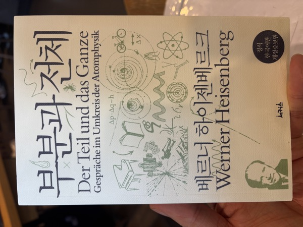

**분류:** 과학사 · 과학철학 · 회고록 — 베르너 하이젠베르크 지음, 서커스

**독서 구분:** 자유도서

[『물리와 철학』]()에 이어 두 번째로 읽은 하이젠베르크의 책이다. 『물리와 철학』처럼 다소 건조한 문체로 쓰인 책일 거라 생각했는데, 막상 펼쳐보니 회고록이었고 대화 중심의 문체로 쓰여 있었다. 다만 실제 대화를 직접 기록한 것은 아니고, 저자가 자신의 기억과 개인 기록에 의존해 사후적으로 대화 형태로 집필한 책이다. 단순히 어려운 책일 것 같아서 차일피일 미뤄왔던 것이 오히려 아쉬울 정도였다.

---

인지와 이해, 상보성의 원리, 그리고 인문사회 영역으로 보이는 언어와 종교 등 단순히 과학적인 개념이 아니라 인간이 개념들을 어떻게 받아들이느냐에 따라서 설명하는 방법을 고민해야하고, 설령 새로운 방법론( e.g., 양자역학 )이 수립되었다 하더라도 고전역학인 표현으로도 이것을 설명하려는 고민이 인상깊었다. 단순히 자기만족이 아니라 사회에서의 합의와 인정 이후에 다음 단계로 나아가려는 과학자 집단에 대해서 한번 더 간접적인 체험을 한 기분이었다.

---

이 책을 읽으면서 가장 만족스러웠던 점은, 항상 안고 있던 궁금증이 상당 부분 해소되었다는 것이다. 세계대전 당시 과학자들이 시대적 상황에 따라 어떤 마음가짐을 가졌고, 시대적인 난국에 대해 어떤 고민을 했는지 다룬 콘텐츠를 아직 접하지 못했기 때문이다.

1차 세계대전 이후 2차 세계대전을 겪은 과학자들의 심정은 대부분 승전국인 미국의 입장, 즉 미국으로 이민해 정착한 과학자들이나 맨해튼 프로젝트에 참여한 과학자들의 입장이 주를 이루었다. 반면 이 책은 끝까지 독일에 남아 있었던 하이젠베르크의 입장에서 쓰였다. 하이젠베르크 개인과 그 주변 인물들로 범위가 한정되기는 하지만, 당시 독일에 있던 과학자의 입장을 알 수 있는 몇 안 되는 자료로서 가치가 있다는 생각이 들었다.

---

과학자들의 논쟁은 전쟁 중에도 이어졌다. 정치적인 현안과 과학적인 현안의 국경은 서로 달랐고, 영화 그래비티의 "과학에는 국경이 없다"라는 대사가 떠오르기도 했다.

책에 가장 많이 등장하는 인물 중 한 명은 닐스 보어다. 닐스 보어는 덴마크의 과학자로, 하이젠베르크를 제자로 받아들이고 공동 연구를 수행했던 당시의 입지전적인 인물이다. 과학자들의 우정은 국적이 아니라 바라보는 관점과 과학적인 가치관에 따라 나뉜다는 것을 이 책을 통해 다시 한번 확인할 수 있었다. 물론 직접적인 피해를 입어 생존과 과학 연구에 영향을 받는 상황이라면 또 다른 이야기가 되겠지만.

---

과학자들이 연구만 하는 것이 아니라 여행도 곧잘 다녔다는 점도 신선했다. 그 여행도 휴식만 하는 것이 아니라 하이킹, 스키 같은 꽤 고강도의 액티비티를 즐겨 했다. 우리나라에서 과학자 하면 떠오르는 이미지는 책상 앞에 앉아 종이와 펜, 혹은 PC 앞에서 연구만 하는 모습이었는데, 문화권이 달라서인지(우리나라는 선비 문화의 연장선, 유럽이나 미국 문화권은 생활체육과 활동성이 기본적으로 있는 문화이니까) 예상하지 못한 내용들이 신기했다.

연구 시간 이외에도 이러한 친목 활동을 통해 의견을 교환하는 수준 높은 대화들이 평소 연구에 큰 도움이 되었겠다는 생각이 들었다. 나이가 들어갈수록 가치관에 대해 이야기할 수 있는 사람이 옆에 있다는 것은 큰 축복이라는 말을 들은 적이 있는데, 이런 면에서 과학자들의 만족감은 높았을 것으로 생각되어 한편으로는 부럽기도 했다.
