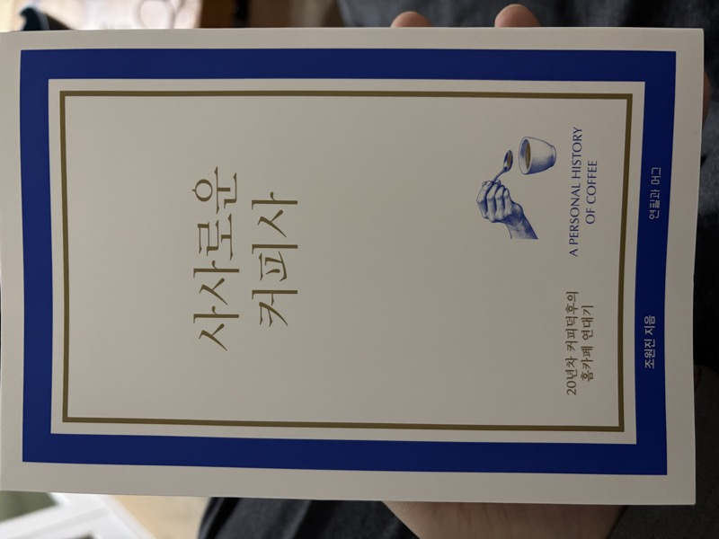
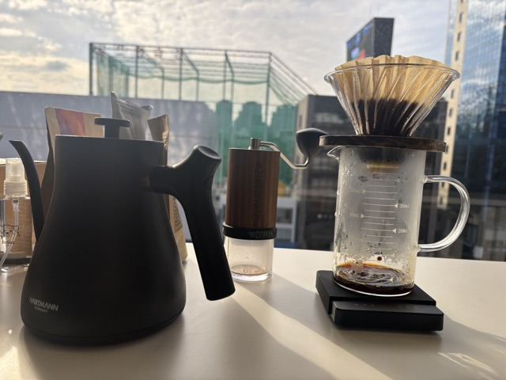

**분류:** 에세이 · 커피 — 조원진 지음, 연필과 머그

**독서 구분:** 자유도서

조원진 작가의 책을 읽는 것은 이번이 처음은 아니다. 실용 커피 서적으로 처음 접했고, 그 책을 주제로 한 독서 모임에서 직접 만나 뵈었을 때 얼마나 커피에 진심이신지 느낄 수 있었다. 어느 한 분야에 취미 이상으로 몰입해 있는 분을 보며 리스펙 하면서도, 한편으로는 부럽기도 했다. 성공한 덕후의 표본 같은 느낌이랄까?

---

저자의 홈카페에 대해서는 이 책을 통해 처음 알게 되었지만 어색하지는 않았다. 오히려 홈카페 세팅이 되어 있지 않으셨다면 그쪽이 더 어색하게 느껴졌을 것 같다. 나도 홈카페까지는 아니지만 나름대로 오피스카페 세팅을 하고 출근해서 커피를 내리는 것으로 루틴이 잡혀있기에, 홈카페를 꾸려 가는 과정을 흥미롭게 읽을 수 있었다.

다만 책에서 소개된 홈카페는 에스프레소 중심이었고, 나는 핸드드립 위주라 그 점에서 큰 차이가 있었다. 책에 언급된 수많은 기구 이름 중에서 내가 알고 있던 것은 코만단테 하나뿐이었다.

---

코만단테는 실제로 내가 쓰고 있는 그라인더이기도 하다. 앞서 말한 커피 독서 모임에서 "커피 기구 중 단 하나에만 투자해야 한다면 그라인더에 투자하라"는 말을 듣고 당일에 구매했다. 해외에 나갈 때도 동행하며 3년째 말썽 없이 잘 쓰고 있다. 내구성도 알아주는 것 같으니, 잃어버리지만 않는다면 평생 쓰지 않을까 싶다.

개인적으로 느끼는 코만단테의 가장 큰 장점은 정성적인 영역에 있다. 더 좋은 그라인더가 있다, 혹은 있을지도 모른다는 불안감에 다른 그라인더를 알아보는 일을 차단해 주는 "심신안정" 효과다. 지구 최강의 핸드밀 그라인더는 아닐 수 있지만, 적어도 코만단테를 쓰고 있다면 아쉬운 소리는 듣지 않을 것이라는 확신이 있기 때문이다. (다른 장점도 많지만, 그것들은 코만단테만의 장점은 아니기에..)

---

책을 읽으며 저자의 주변에 좋은 커피 지인들이 많이 계시다는 점도 보기 좋았다. 취미생활에서 생기는 궁금증을 함께 고민하고 논의할 분들이 많은 것 같았다. 나도 이제 커피로 재미있게 대화할 수 있는 분들이 주변에 조금씩 생기는 것 같은데, 다른 취미(우주, 망원경 등)는 그런 분들을 만나기가 쉽지 않을 것 같다.

저자께서는 내 버킷리스트 중 하나인 커피 산지 견학 같은 여행도 꾸준히 하고 계신 것 같았다. 이 부분은 솔직히 부러웠지만, 나 또한 조만간 가 볼 수 있겠지 하는 희망을 다시 되새기게 되었다. 파워J답게 차곡차곡 계획을 세우고 마일스톤을 찍어 봐야겠다.
