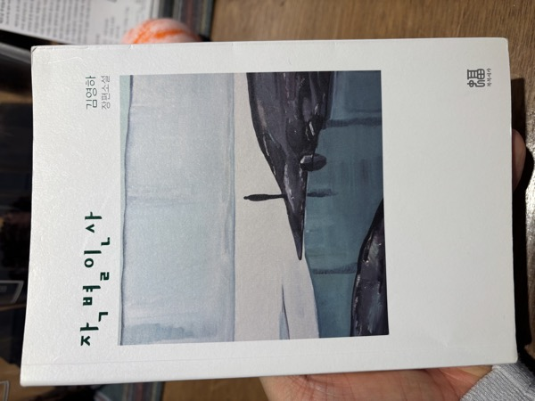

**분류:** 한국문학 · 장편소설 · SF — 김영하 지음, 복복서가

**독서 구분:** 자유도서

직장 동료의 추천으로 읽은 김영하 작가의 장편소설이다. 시대적 배경은 통일이 된 이후의 미래이고, 공간적 배경은 평양이다. 휴먼매터스라는 회사에서 최첨단 휴머노이드 로봇을 제작하는 최진수 박사가, 자신이 공들여 만든 휴머노이드 로봇 철이와 함께 생활하는 이야기로 시작한다.

---

책 초반부에서 최진수는 철이에게 클래식을 가르치고, 사람이 가져야 하는 마음과 감성에 대해서까지 굳이 가르쳐준다. 그리고 곧잘 익히는 철이를 보며 매우 흐뭇해한다. 대부분의 부모라면 그러하겠지만, 그 모습이 유난히 기뻐하는 것처럼 느껴졌다. 작가의 의도일 수도 있다.

책을 다 읽고 나서야 이 부분이 이해되었다. 최진수 박사는 국가에서도, 회사에서도 허용되지 않는 스펙의 휴머노이드 로봇으로 철이를 만들었고, 철이를 가르치는 것은 테스트를 겸해 그 결과물을 확인하는 과정이었던 것이다. 한 번 더 생각해보면, 철이에게 엄마가 묘사되지 않았다는 점도 새삼 눈에 들어왔다.

철이는 마지막에 스스로 생을 마감하는 것을 받아들인다. 이를 통해 인간으로서의 요소가 완성되는 것으로 느껴졌고, 철이의 마지막 모습을 보면서 소설의 제목도 이해가 되었다.

---

소설은 여러 화자들을 통해 인간의 자아와 존재성에 대해 생각할 거리를 던져준다. 생물학적인 이유가 아니라 의식적인 이유에서 철이가 왜 인간이 아닌지를 논하자면, "XX 때문이다"라는 결론을 내리기가 어렵다. 설령 유사한 결론을 내린다 하더라도, 같은 기준을 인간이 아닌 동물에 적용했을 때 그 동물에게 의식이 없다고 결론 내릴 수는 없기 때문이다. 물론 동물은 메타인지가 되지 않는다는 점에서 인간과 큰 차이가 있지만.

---

로봇은 이론적으로 전원이 공급되고 유지보수만 된다면 영생이 가능하다. 하지만 인간은 그렇지 못하다. 그래서 소설에서는 자신의 의식을 클라우드에 업로드해 영생하는 방식을 택하는 모습도 나온다.

이 부분을 읽으며 몇 가지 의문이 들었다. 이렇게 얻은 영생이 진정한 영생인지, 영생이란 무엇인지, 물리적인 틀을 벗어나는 것이 좋은 것인지.

육체를 벗어나서도 사유할 수 있고 의식을 통해 적절한 의사표현을 할 수 있다면 영생이라고 볼 수도 있다. 하지만 우리가 물리적인 한계를 벗어나는 것은 불가능하다. 적어도 현재 기술에서는 그렇다. 클라우드처럼 가상의 공간에 의식을 데이터화해서 업로드한다고 하더라도, 그 클라우드 서비스를 돌리기 위한 물리적인 서버는 궁극적으로 필요하기 때문이다. 결국 육체를 벗어난다 한들 새로운 물리적인 환경에 의존할 수밖에 없는 시스템이다.

물론 소설에서처럼 네트워크가 닿는 곳이라면 쉽게 이동할 수 있으니 나아지는 점은 분명히 있을 것이다. 그때에는 실제로 보고 듣고 느끼는 것도 지금과 다를 것으로 예상되지만, 소설의 범위를 넘어서고 현재로서는 알기 어려운 부분이라 여기에서는 적지 않겠다.

---

소설을 읽고 이렇게 생각이 많아진 것은 거의 처음인 것 같다. 철학적인 내용을 담고 있어서인지도 모르겠다. 『차라투스트라는 이렇게 말했다』도 소설이기는 하지만 소설을 표방한 철학책에 가까웠고, [『싯다르타』]() 또한 자기성장소설로서 메시지를 담고 있지만 이 정도로 많은 생각거리가 느껴지지는 않았다.

소설 중에서는 처음으로, 나중에 몇 번은 다시 읽게 될 것 같은 책을 발견한 느낌이다.
