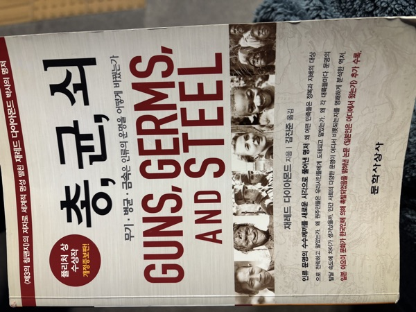

**분류:** 인문 · 인류사 — 재레드 다이아몬드 지음, 김진준 옮김, 문학사상

**독서 구분:** 자유도서

워낙 유명한 책이라, 읽기 전에도 이 책이 말하고자 하는 바가 무엇인지는 이해하고 있다고 생각했다. 읽어보니 이해는 하고 있었지만, 역시 겉핥기식으로 이해하고 있던 것이었다.

인류는 현재 지역 기준으로 아프리카에서 시작해 세계 곳곳으로 퍼져 나갔다. 그런데 왜 어느 곳은 현대 문명의 혜택을 누리고, 다른 곳은 여전히 원시시대, 구석기 시대와 비슷한 생활을 하고 있을까. 이 책은 그 차이를 하나의 관점으로 설명하는 통찰을 제공한다.

---

골자는 '식량생산'이다. 식량 생산량이 늘어나고 그것이 일정해지면 인구를 늘릴 수 있고, 이는 곧 세력 경쟁에서의 우위로 이어진다.

세력 내부에서도 변화가 생긴다. 식량 생산에 관여하지 않고도 생산물을 취할 수 있는, 이른바 군림하는 계층이 생겨난다. 하루 중 식량 생산에 시간을 쓰지 않아도 되는 이들은 상위 계층으로 분류되고, 사회의 틀을 잡고 내부를 통제하는 룰을 만들어 관리하는 역할을 맡게 된다.

단순히 규모만 커지는 것이 아니다. 궁극적으로는 집단 지성이 발생하고, 이를 후대에 전하기 위한 교육 시스템도 형성된다. 이렇게 부락에서 촌장 사회로, 다시 국가로 점점 틀을 다져 가며 사회가 발전한다는 하나의 관점을 제시한다.

---

식량 다음으로는 가축이다. 동물을 길들이고 가축화하는 과정에서 사람들은 여러 균에 노출되었고, 그 균을 견딜 수 있었던 사람들만 살아남으면서 집단면역이 형성되었다. 이런 과정을 겪지 못한 사회는 집단면역이 생긴 사회와 부딪혔을 때 매우 취약할 수밖에 없다.

그리고 이러한 식량생산과 가축화는 기후에 크게 의존한다. 고도나 주변 해양의 분포에 따라 달라지기는 하지만, 같은 조건이라면 동서 방향으로는 기후가 비슷하다. 그래서 동서로 전파된 작물은 같은 방식으로 농사를 지어도 성공할 가능성이 높았고, 동물의 분포도 비슷했으니 가축의 전파도 쉬웠을 것이다. 반면 남북 방향으로는 기후가 달라지기 때문에 교류가 매우 더뎠다.

저자가 말하는 신대륙, 즉 아메리카 대륙은 동서보다 남북으로 길게 이어진 대륙이다. 그래서 원주민들은 각 조직의 규모가 작았고 그것을 키우기도 어려워, 발전에 속도를 붙이지 못했던 것이다.

---

이 밖에도 수많은 예시로 등장하는 뉴기니라는 지역의 특수성, 인류의 이주와 식량, 구대륙과 신대륙의 차이 등 세부적인 내용들도 알게 되었다. 하지만 개인적으로 가장 크게 남은 것은 따로 있었다. 사회의 발전을 설명하는 기능론과 갈등론 중에서 갈등론이 더 타당하다는 것, 그리고 성악설이 맞다는 평소의 생각에 더 힘이 실렸다는 점이다.

식량생산으로 사회가 커질수록 다른 사회와 부딪히고 정복이 일어난다. 그리고 필연적으로 시스템이 복잡해진다. 우리나라 고조선의 8조금법만 해도 지금은 3개 조항이 전해지지만, 이후에는 60여 개 이상으로 조항이 늘었다는 기록까지 전해진다.

극단적으로 말해, 성선설의 관점으로 이렇게 인류가 발전해 온 과정을 설명할 수 있을까? 사회적인 갈등을 해결하는 과정에서 사회가 발전한다는 관점 또한 성선설로 설명할 수 있을까? 하는 생각이 들었다. 그만큼 나 스스로도 반듯해지기 위해 항상 의식적으로 노력해야겠다는 생각도 함께 들었다.

---

내용과는 별개로, 이와 비슷한 책을 읽을 때마다 느끼는 점이 있다. 비슷한 내용이 반복된다는 느낌이다. 이 책 이전에 읽은 유발 하라리의 『넥서스』도 그랬고, 좋아하는 분야이지만 『코스모스』 역시 그런 느낌을 지울 수는 없었다. 다음에 다시 읽을 때면 또 다른 느낌을 받을 수 있겠지만.
