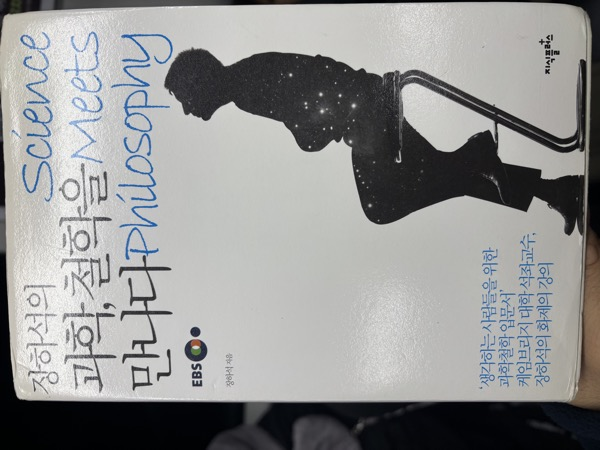

**분류:** 과학철학 · 과학사 — 장하석 지음, 지식플러스(EBS)

**독서 구분:** 지정도서

과학철학 책 중에서 가장 편하게 읽히는 책으로 느껴졌다. 저자가 한국인이라서 그런 것일 수도 있지만, 강의를 바탕으로 이야기 형식으로 전개되는 덕분에 에세이를 읽듯 편하게 진도를 나갈 수 있었고, 생각할 거리도 많이 남겨주었다.

얼마 전 토머스 쿤의 『과학혁명의 구조』를 읽었는데, 한 번 읽어서는 이해가 잘 가지 않았다. 이 책에서는 쿤, 그리고 쿤과 비견될 만한 포퍼의 과학사상이 함께 언급되는 경우가 많아서 그 책에 대한 해설서 느낌도 조금 있었다. 『과학혁명의 구조』는 아무래도 쿤 자신의 책이다 보니 하나의 입장에 치우친 느낌이 있었는데, 이 책은 쿤의 정상과학 개념을 비판했던 칼 포퍼의 철학도 균형 있게 설명해서 좋았다.

라부아지에 사례도 다시 접했다. 라부아지에의 화학 이론이 정설로 받아들여진 계기가 명확하지 않아서 오히려 더 헷갈리게 된 느낌이었다. 저자는 라부아지에가 주장한 산소 이론이 증거상 압도적으로 우월해서 채택된 것이 아니며, 산소 이론에도 문제가 있었고 플로지스톤 이론에도 살릴 만한 장점이 있었다고 본다. 플로지스톤 이론이 너무 일찍 버려졌다는 이 문제의식은 뒤에 나오는 다원주의로 이어진다.

나의 생활과 밀접한 영역도 있었다. 매일 출근하면 아침마다 커피를 내리는데, 94도로 세팅해서 추출하면서도 그 94도에 대해서는 비판적으로 생각해 본 적이 없는 것 같다. 수은 온도계가 아니라 디지털로 표시되는 숫자 온도는 어떤 기준으로 표기되는 것인지, 그리고 같은 94도로 표기되더라도 그때그때 실제 온도는 다를 수 있겠다는 생각도 들었다. 물의 끓는점조차 조건에 따라 달라지고, 온도계가 맞는지 확인하려면 이미 온도를 알아야 하는 순환의 문제가 있다는 이야기가 그래서 더 와닿았다.

수많은 교양과학 콘텐츠를 접하면서 시간은 상대적이라는 것에는 익숙해졌지만, 온도 측정의 문제나 관측 결과가 관측자뿐 아니라 이론의 영향도 받는다는 관점(관찰의 이론적재성) 등 새롭게 접하는 내용도 많았다. 생각해 보면 맞는 말들인데, 이마저도 주입식으로 받아들여서 응용이 잘 안 되는 경우 중 하나인 것 같다. 익숙한 것을 당연하게 받아들이지 않고 사소한 것 하나하나 의심했던 데카르트가 생각나기도 했다.

저자는 다원주의 관점을 취한다. 자칫 "얘 말도 맞고 쟤 말도 맞다"는 황희정승 이론으로 비난받을 수 있지만, 저자도 이런 비판을 염두에 두고 다원주의가 상대주의와 다르다는 점을 분명히 한다. 여러 체계를 인정하되, 각 체계는 여전히 경험적 성과로 평가받아야 한다는 것이다. 패러다임이 있어야 연구가 생산적이라는 쿤의 통찰과, 비판이 멈추지 않아야 한다는 포퍼의 통찰을 함께 살리려는 시도로도 읽혔다. 여러 체계가 공존하면 각 체계 안에서 깊이 있는 연구를 하면서도 서로를 비판할 수 있기 때문이다. 결국 중요한 것은 과학이 발전하기 위해 필요한 과학자의 자세를 공통으로 전제한다는 점이고, 그런 점에서 괜찮은 관점이라고 생각한다.

책에서 말하는 다원주의는 과학의 지식 체계에 관한 것이지만, 개인적으로는 삶에도 적용할 수 있을 것 같다. 세상을 꼭 하나의 관점으로만 설명할 필요는 없고, 다양한 사람들이 살아가는 사회를 하나의 관점으로만 바라보는 것은 오히려 위험한 생각인 것 같다.

다음에 읽을 책 리스트에 『온도계의 철학』을 추가해 두었다. 같은 저자의 책이니 또 재미있게 읽을 수 있을 것 같다.
