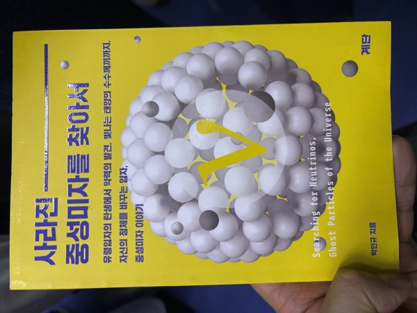

**분류:** 교양과학 · 입자물리학 — 박인규 지음, 계단

**독서 구분:** 지정도서

독서모임을 하는데(물론 과학을 주제로 한 독서모임), 모임장님께서 좋은 책이라며 추천 해 주신 책이라 궁금해서 읽어봤다. 내용은 사실 이해하기 어렵다. 다소 가벼운 마음으로 이 책을 대했는데, 교양과학책이라기보다는 중성미자 혹은 입자물리학을 학문적으로 이미 어느 정도 알고 있는 상태에서 읽으면 꽤 재미있게 읽히겠다는 생각을 했다. 이 책을 통해 중성미자가 언제, 왜 생기는지, 중성미자에도 종류가 있고 그것이 왜 다른지, 그리고 관측은 어떻게 하는지 등에 대해 알게 되었다.

---

### 중성자별과 헷갈렸던 중성미자

사실 내가 알고 있던 중성미자의 개념은 중성자별과 헷갈리고 있었던 것 같다. 항성의 생애 말미에 특이점으로 가는 붕괴 과정에서, 양성자(+)와 전자(-)가 합쳐지지 않게 하던 힘보다 더 센 중력이 작용해 둘이 합쳐지면서 중성이 되고, 그것이 중성자별이 된다는 식이었다. 그러다 막판에 중력을 이겨내고 양성자와 전자가 서로 밀어내는 반발력이 터지면 그게 초신성이 되고, 중력이 그보다 더 세면 그대로 붕괴하면서 블랙홀이 되는 것으로 알고 있었다. 내가 헷갈렸던 중성자별은 그 와중에 힘의 평형을 이루어서 붕괴가 되지 않은 상태였다.

(그런데 이 글을 작성하면서 내가 알고 있는 내용이 맞는지 클로드에게 물어보니, 초신성으로 폭발하면서 블랙홀이 생기는 경우도 있어서 둘은 서로 배반사건이 아니라고 하네..? 그렇게 생긴 블랙홀로 항성 질량 블랙홀이라는 것이 있다고 한다. 역시 공부할 것은 많다.)

아무튼 중성미자는 말 그대로 중성자가 아니라 중성미자이기에, 내가 알고 있던 항성 생애 막바지 메커니즘과는 상관없다. 물론 막바지에 중성미자가 더 많이 나오기도 한다. 심지어 초신성이 폭발하기 전부터 전조 증상으로 중성미자를 관측해 폭발을 예상해볼 수도 있다.

---

### 파울리의 예측에서 표준모형까지

파울리가 예측한 중성미자는 이제 예측이 아니라 당연히 존재하는 것으로 표준모형에서 설명하고 있다. 이런 것을 볼 때마다 쿤의 정상과학이 자꾸 상기된다.

---

### 중성미자 관측과 실험물리학자

태양에서도 중성미자가 꽤 많이 발생하고 있고, 나와는 거의 상호작용하지 않기 때문에 그냥 내 몸을 통과한다고 한다. 그것을 어떻게 관측할 수 있을지 방법론을 고민한 과학자들이 대단하게 느껴졌다. 그 이후 관측 방법을 현실로 구현할 때에는 과학자들의 광기마저 느껴질 정도였다. 무언가에 미치면 이렇게 될 수 있구나 싶었다.

요즘 AI로 인해 나의 역할은 사라지지는 않지만 본질적인 역할은 바뀌고 있는 과도기에 있다고 느끼는데, 실험물리학자는 AI가 대체하기 어려울 것 같다는 생각이 들었다. 이론물리학자 중에도 AI가 학습한 내용 그 위를 연구하는 과학자가 있겠지만, 곧 이론물리학적인 추론도 AI가 잘하게 되지 않을까 싶다.

---

### 기초과학 투자와 후원

이러한 순수과학, 그리고 기초과학(난이도를 기초라고 할 수 있을지는 모르겠지만)에 투자를 받으며 연구하는 과학자들은 국가의 예산 집행 허가나 기업가의 기부로 연구를 진행하는 경우가 많다는 것을 새삼 느꼈다. 갈릴레오가 살았던 시기의 유럽에서도 연구를 위해서는 귀족의 후원이 필수였다고 들었는데, 요즘도 별반 다를 게 없다고 느껴졌다.

한편으로는 책을 읽어가면서 CERN, LIGO 등 기초과학 연구가 주로 해외에서 이루어지고 있는 것 같아 아쉬움이 느껴졌다. 하지만 책 말미에서 우리나라에서도 그러한 투자가 이뤄지고 있다고 언급하며 나름 해피엔딩으로 마무리되어 다행이라는 생각이 들었고 기분이 좋았다.
