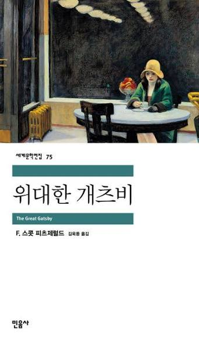

**분류:** 영미문학 · 장편소설 — F. 스콧 피츠제럴드 지음

**독서 구분:** 지정도서

아주 예전에 영화로 한 번 본 작품이다. 주인공은 개츠비지만 화자는 데이지의 사촌인 닉 캐러웨이이고, 소설은 1인칭 관찰자 시점으로 전개된다.

---

### 줄거리: 데이지를 되찾으려 한 개츠비

개츠비는 젊은 장교 시절 짧게 만났던 데이지를 잊지 못한다. 개츠비가 전쟁에 나가 있는 동안 데이지는 톰 뷰캐넌과 결혼했고, 개츠비는 그 사실을 알면서도 큰 부를 쌓은 뒤 만 건너편 데이지의 집이 보이는 곳에 대저택을 산다. 그리고 매일같이 파티를 연다. 파티에 오는 사람을 따로 가리지 않다 보니, 주최자가 누구인지, 왜 파티를 여는지에 대해 무성한 소문이 돈다.

처음에는 만 건너편의 초록 불빛을 바라보기만 하던 개츠비는 닉을 통해 결국 데이지와 재회한다. 이후 데이지가 운전하던 개츠비의 차가 톰의 내연녀 머틀을 치는 사고가 나고, 개츠비는 자신이 운전한 것으로 하겠다며 책임을 떠안으려 한다. 톰은 머틀의 남편 윌슨에게 그 차가 개츠비의 것이라고 알려주고, 윌슨은 개츠비를 찾아가 총으로 쏜다. 데이지는 톰과 함께 떠나고, 개츠비의 장례식에는 그 많던 파티 손님이 거의 오지 않는다.

---

### 영화로 볼 때와 다르게 읽힌 개츠비

예전에 영화를 볼 때는 개츠비의 행동이 충분히 그럴 수 있다고 생각했다. 그런데 이번에 책으로 읽으면서는 이해가 잘 가지 않았다. 영화와 책의 차이라기보다는 그때의 나와 지금의 나의 차이 때문인 것 같다. 그때보다 성격이 현실적으로 바뀐 탓일 것이다. 그래서 처음에는 작가가 왜 개츠비를 이렇게까지 표현했는지 의아했다.

다시 생각해보면, 작가가 개츠비의 사랑을 이상적인 사랑으로 그린 것은 아닌 것 같다. 개츠비가 붙잡으려 한 것은 지금의 데이지라기보다 5년 전의 데이지인것 같다. 그리고 데이지가 상징하는 상류층으로의 진입을 원한 것일지도 모른다. 개츠비 스스로 데이지의 목소리가 돈으로 가득 차 있다고 말하는 장면도 있다. 결말에서 데이지가 개츠비를 떠나고 장례식에도 오지 않는 것을 보면, 개츠비의 집착이 비현실적이라서 비극이 되는 구조로 읽힌다. 지금 이해가 가지 않았던 반응이 오히려 작가의 의도에 가까웠을 수도 있다.

---

### 1920년대 재즈 시대 미국과 아메리칸 드림

이 소설은 시대적 배경을 잘 보여주는 작품으로도 꼽힌다. 배경은 1922년 여름으로, 1929년 대공황이 오기 전 금주법과 재즈 시대의 미국이다. 그 안의 가면 쓴 모습과 뒷일을 생각하지 않는 사람들의 생활이 그려진다. 당시 미국은 세계 최강대국으로서의 입지를 다져가던 시기였고, 계층에 따라 정도는 다르겠지만 그 시기 사람들의 생활양식을 엿볼 수 있다.

물려받은 부를 가진 사람들이 사는 이스트에그와 새로 부를 쌓은 사람들이 사는 웨스트에그의 대비도 눈에 띈다. 개츠비는 큰 부를 가졌지만 끝내 톰과 데이지의 세계에 들어가지 못한다. 노력하면 누구나 성공할 수 있다는 아메리칸 드림의 허상을 보여주는 부분으로, 이 작품이 고전으로 평가받는 이유도 시대 묘사보다 이쪽에 더 가까운 것 같다.

---

### 반영론적 관점에서 본 『위대한 개츠비』

문학 작품을 바라보는 네 가지 관점 중에서는 반영론적 관점에 충실한 소설로 느껴진다. 다만 피츠제럴드 자신이 그 시대의 화려한 생활을 직접 살았던 사람이라는 점에서 표현론적 관점으로도 읽을 수 있을 것 같다. 개인적으로는 그 시절 미국에 크게 관심이 가지 않아서, 시대를 기록한 작품으로서의 의의는 크게 와닿지 않았다.

---

### 개츠비의 감정은 사랑인가, 집착인가

개츠비는 현실에 존재할 법한 인물일까? 말 그대로 소설에서나 볼 법한 이야기일지도 모른다. 누군가를 너무 사랑한 나머지 죄를 대신 뒤집어쓰는 경우는 부모와 자식 관계 말고는 떠오르지 않는다. 조직 생활에서 부하 직원이 대신 죄를 뒤집어쓰고 감옥에 가는 경우가 왕왕 있다고는 하지만, 그것을 사랑에서 비롯된 것으로 보기는 어렵다고 생각한다.

그렇다면 개츠비의 감정은 사랑일까, 꿈에 대한 집착일까. 진정한 사랑이 무엇인지는 사람마다 다를 텐데, 어디까지 허용되고 어디부터 그렇지 않은지는 앞서 읽은 『과학, 철학을 만나다』에서 다룬 다원주의 관점으로 바라보는 것이 가장 맞을지도 모르겠다. 공동선에 위배되지 않는다면, 형태가 다양하더라도 어떤 사랑이 더 좋고 나쁜지를 구분하는 것이 무슨 의미가 있을까 싶다. 각자 원하는 방식은 다를 수 있어도, 큰 범위 안에서는 틀린 것이 아니라 다른 것이라는 생각이 든다.
